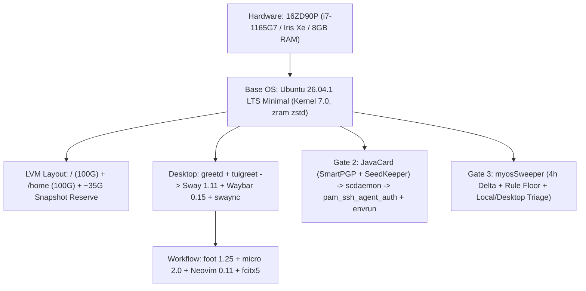

# myOs

A minimal, reproducible, **CLI-first Sway desktop** built on **Ubuntu Server 26.04.1 LTS Minimal** (`Linux 7.0`), engineered for low-RAM hardware (**8GB soldered RAM**, `LG gram 16ZD90P-GX7BK`) with hardware-backed JavaCard authentication and an autonomous `/` security sweeper.

---

## Core Philosophy

- **Minimal & Reproducible**: `Ubuntu Server 26.04 Minimal` + `bootstrap.sh` + GNU `stow` — no desktop-environment bloat, `snapd` purged, `NetworkManager` + `systemd-logind` native.
- **No-Glyph, Text-Only UI**: Plain ASCII/CJK across `sway`, `waybar`, `swaync`, `wofi`, and `tuigreet` — zero Nerd Font or icon-pack dependencies.
- **Floating-First Ergonomics**: New windows open centered at `800x600` floating and toggle cleanly into tiling (`$mod+space`).
- **8GB RAM Budget**: `zram` (`zstd`, 50% RAM), `docker.socket` on-demand activation, and heavy AI/ML workloads offloaded over Tailscale.
- **Hardware-Backed Auth + Full Fallback**: JavaCard (`SeedKeeper` + `SmartPGP` `nistp256`) handles SSH, Git signing, `sudo`/`sudo-i`, and `.env` encryption with 100% password/offline-key fallback.
- **Standalone Security Sweeper**: `myosSweeper` monitors `/` deltas, listening ports, SUID changes, and auth logs without any external commercial AI CLI dependency.

---

## Design Intent (Why Each Component)

- **Ubuntu Server 26.04 LTS Minimal**: Chosen as the base for **ROS 2** readiness (first-class Ubuntu support for future robotics work) paired with 5-year LTS stability and zero desktop bloat.
- **Sway + Wayland**: Selected purely for **hardware resource efficiency** on 8GB soldered RAM—minimal idle footprint with native Wayland performance and full GUI compatibility.
- **JavaCard Hardware Key**: Inspired by the **CAC (Common Access Card)** workflow from military service—practical, tamper-resistant physical authentication for SSH, Git, `sudo`, and `.env` secrets.
- **`myosSweeper` (Self-Hosted AI HIDS)**: Built as a testbed for a **self-hosted, AI-assisted HIDS (Host-based Intrusion Detection System)** that runs independently of any commercial coding agent or cloud API.

---

## Architecture Overview



---

## Stack & Verified Footprint

| Component | Version / Configuration |
| :--- | :--- |
| **OS / Kernel** | Ubuntu 26.04.1 LTS (`resolute`), `Linux 7.0.0-43-generic` |
| **Window Manager** | `sway 1.11`, `waybar v0.15.0`, `swaync`, `wofi`, `tuigreet` |
| **Terminal / Editors** | `foot 1.25.0`, `micro 2.0.15` (`$EDITOR`), `Neovim v0.11.6` |
| **Audio / Network / BT** | `pipewire` + `wireplumber`, `NetworkManager`, `bluez` + `bluetui` |
| **Power / Memory** | `tlp` + `thermald`, `zram0` (`3.5G zstd`) + `/swap.img` fallback |
| **Idle / Active Footprint** | ~2.8 GiB RAM (with Brave active), `/` ~15 GiB used, `/home` ~3.8 GiB used |

---

## Quick Start (Fresh Ubuntu Server 26.04 LTS Minimal)

> **Intended Use**: `myOs` is designed **exclusively for local, laptop-on-hand (physical console) deployment** — **not** for remote/headless SSH stands. `bootstrap.sh` enforces a strict laptop-first security posture (`UFW` default-deny inbound allowing only `41641/udp` Tailscale, `SSHD` `PasswordAuthentication no`, `NetworkManager` netplan cutover, and Wayland `pinentry-labeled` confirmation for JavaCard `sudo`/SSH auth). If invoked over an active `SSH_CONNECTION`, lockout-prone `SSHD` and `UFW` cutover steps are automatically skipped with a warning.

```bash
sudo apt update && sudo apt install -y git
git clone https://github.com/raybeak/myOs.git ~/myOs
cd ~/myOs
./bootstrap.sh --dry-run   # preview actions
./bootstrap.sh             # deploy packages, stow dotfiles, /etc, services, netplan
sudo reboot
```

### Repository Structure

- `bootstrap.sh`: Idempotent 8-stage installer (`remove.txt` -> `packagesV2.txt` -> external tools -> `stow` -> `/etc` & `UFW` baseline -> `servicesV2.txt` -> `micro` default -> `NetworkManager` cutover).
- `dotfiles/`: GNU `stow` packages (`sway`, `waybar`, `swaync`, `foot`, `micro`, `fcitx5`, `gnupg` with `--no-folding`, `myos-bin` with `--no-folding`, `shell`, `btop`, `Thunar`, `gtk-3.0/4.0`).
- `etc/`: System configs (`greetd/config.toml`, `netplan/01-nm.yaml`, `systemd/zram-generator.conf`, `tlp.d/90-gram.conf`, `sudoers.d/ssh-agent`, `sudoers.d/myos-battery`, `local-sbin/myos-battery-ctl`, `security/authorized_keys`, `ssh/sshd_config.d/01-hardening.conf`, `sysctl.d/99-hardening.conf`).
- `sweeper/`: Standalone `/` security delta collector, rule floor, local/Tailscale triage, and `systemd` timers.
- `gate2JavaCardStarter.md` / `gate3SweeperStarter.md` / `myosBinGuide.md` / `recoveryRunbook.md`: Module setup, operational & DR guides.

### `myOs` CLI Toolbox (`~/.local/bin/myos-*`)

Modular text-only desktop & system utilities stowed via `dotfiles/myos-bin` (`--no-folding`); see `myosBinGuide.md` for full per-tool documentation:

- `myos-menu` (`$mod+Alt+space`): Unified `wofi --dmenu` action center (toggles, screenshots, TUI/WebApp launchers, security/system actions, Sway keybindings cheatsheet, power).
- `myos-screenshot` (`Print` / `Shift+Print`): Saves region/full capture to `~/photo/screenshots/` and copies to clipboard (`wl-copy`).
- `myos-toggle-idle` / `myos-toggle-nightlight`: Toggle `swayidle` caffeine mode and `wlsunset` warm temperature (with `status` query).
- `myos-brightness` (`Fn+F2` / `Fn+F3`): Logind seat-scoped backlight control (5% grid snap, `2%` floor, `--locked`).
- `myos-toggle-touchpad` (`Fn+F5`): Sway touchpad toggle with logind `tpad_led` LED sync (zero-root).
- `myos-toggle-charge` (`Fn+F1`): Toggle LG battery care (80%) and full charge (100%).
- `myos-display` (`Fn+F7` / `$mod+p`): Sway-native `get_outputs` + `wofi` output switcher.
- `myos-launch-tui` / `myos-webapp`: Standardized floating `foot` TUI wrapper (`app_id=myos-tui`) and frameless Brave `--app=` `.desktop` manager.
- `myos-update`: LVM pre-upgrade snapshot guard (`ubuntu-vg/myos-pre-*`, `8G`, keep 2, VG free-space check) before `apt upgrade`.

### Keymap (Sway & LG gram `16ZD90P` Fn Keys)

Defined in `dotfiles/sway/.config/sway/config` (`$mod` = `Mod4` / `Super`); hardware `Fn` keys live-verified via `xev` + hardware testing:

```text
=== Core & System ===
$mod+Return           foot (terminal)
$mod+d                wofi --show drun --term foot (app launcher)
$mod+Alt+space        ~/.local/bin/myos-menu (action center; $mod+Mod1+space)
$mod+Shift+q          kill focused window
$mod+Shift+c          reload sway config
$mod+Escape           ~/.config/sway/scripts/power.sh (power menu)
$mod+Shift+x          swaylock -f -c 000000 (lock screen)
Print / Shift+Print   ~/.local/bin/myos-screenshot region | full

=== Floating & Window Control ===
$mod+space            floating toggle
$mod+Shift+space      focus mode_toggle (floating <-> tiled)
$mod+f                fullscreen toggle
$mod+c                move position center
$mod+m                resize set width 100ppt height 100ppt, move position 0 0
$mod+Shift+r          resize set 800 600, move position center
$mod+LeftDrag         move floating window (or drag titlebar without $mod)
$mod+RightDrag        resize floating window (or drag border without $mod)

=== Focus, Move & Layout ===
$mod+h/j/k/l (Arrows) focus left / down / up / right
$mod+Shift+h/j/k/l    move left / down / up / right 20px (or swap when tiled)
$mod+b / v            splith / splitv
$mod+s / w / e        layout stacking / tabbed / toggle split
$mod+a                focus parent
$mod+1..9, 0          workspace number 1..10 (+ Shift to move container)
$mod+Shift+minus      move scratchpad ($mod+minus: scratchpad show)
$mod+r                resize mode (h/j/k/l or Arrows: 20px, Return/Esc: exit)

=== Hardware / Fn Keys (LG gram 16ZD90P) ===
Fn+F1  (XF86Launch6, kc 193)                myos-toggle-charge toggle (80% <-> 100%, root helper)
Fn+F2  (XF86MonBrightnessDown, --locked)    myos-brightness down 5 (logind D-Bus, 2% floor)
Fn+F3  (XF86MonBrightnessUp, --locked)      myos-brightness up 5
Fn+F4  (EC-swallowed)                       unused (no userspace event)
Fn+F5  (XF86TouchpadToggle, kc 199)         myos-toggle-touchpad toggle (Sway + logind tpad_led)
Fn+F6  (EC Airplane/Wireless)               EC-managed (do not bind)
Fn+F7  (Super_L+p -> $mod+p)                myos-display (Sway get_outputs + wofi)
Fn+F8  (EC Keyboard Backlight)              EC-managed (0 -> 127 -> 255, no OS binding)
Fn+F9  (XF86Launch5, kc 192)                myos-toggle-nightlight toggle (wlsunset 3750K)
Fn+F10 (XF86AudioMute, --locked)            wpctl set-mute @DEFAULT_AUDIO_SINK@ toggle
Fn+F11 (XF86AudioLowerVolume, --locked)     wpctl set-volume @DEFAULT_AUDIO_SINK@ 5%-
Fn+F12 (XF86AudioRaiseVolume, --locked)     wpctl set-volume -l 1.0 @DEFAULT_AUDIO_SINK@ 5%+
XF86AudioMicMute (--locked)                 wpctl set-mute @DEFAULT_AUDIO_SOURCE@ toggle
XF86AudioPlay / Next / Prev                 playerctl play-pause / next / previous
```

- Note: Waybar `VOL:` / `BRI:` modules are read-only (scroll disabled).

### Workspace `.env` Helpers (`env*`)

Defined in `dotfiles/shell/.config/myos/env-helpers.sh` (Dual-Recipient GPG encryption using `~/.config/myos/gpg-recipients`, resolving `./.env.gpg` first and falling back to `~/workspace/.env.gpg`):

- `envlock [src] [dst]`: Encrypts a plaintext `.env` file into `.env.gpg` for both the JavaCard key and offline/fallback key (`envlock /dev/shm/.env ~/workspace/.env.gpg` recommended to keep plaintext off NVMe).
- `envview [src]`: Decrypts `.env.gpg` directly to stdout without writing plaintext to disk.
- `envrun <command> [args...]`: Decrypts `.env.gpg` in memory and injects variables into an isolated subshell for `<command>` (`ENV_GPG_FILE` overrides path).

---

## Updates

- `docs(readme): replace Fn-only keymap with unified Sway and LG gram Fn keymap`; `2026-11-23 10:27 KST`
- `chore(myos): wire new controls into myos-menu, prune legacy waybar scripts, audit packagesV2, and add recoveryRunbook.md`; `2026-11-20 15:25 KST`
- `feat(battery): add Fn+F1 myos-toggle-charge (80% Care <-> 100% temporary Full) with root-owned helper and strict sudoers`; `2026-11-20 15:18 KST`
- `feat(fn-keys): add myos-toggle-touchpad, myos-display, 3750K nightlight, and LG gram Fn keymap docs`; `2026-11-20 15:06 KST`
- `feat(myos-bin): add modular myos-* CLI toolbox, unified wofi menu, LVM update guard, and myosBinGuide.md`; `2026-11-20 11:46 KST`
- `feat(security): deploy auditd+usbguard+DoT+MAC-rand, Waybar net toggle, root pinentry, and myosSweeper HIDS fixes`; `2026-11-19 18:48 KST`
- `feat(hardening): add reproducible laptop-only SSHD, sysctl, UFW, and JavaCard confirm baseline`; `2026-11-19 10:18 KST`
- `fix(shell): guard bash-only env-helpers.sh in .profile for dash/tuigreet`; `2026-11-17 17:41 KST`
- `chore(repo): untrack compiled __pycache__ bytecode`; `2026-11-17 16:51 KST`
- `feat(gnupg): add pinentry-labeled wrapper for explicit PIN/key titles`; `2026-11-17 16:50 KST`
- `feat(auth): integrate JavaCard SmartPGP, sudo-rs PAM, and .env GPG helpers`; `2026-11-17 16:48 KST`
- `feat(sweeper): add external port details to alerts and Gate 3 starter guide`; `2026-11-17 16:46 KST`
- `feat(sweeper): add Gate 3 myosSweeper pipeline and waybar sec heartbeat`; `2026-11-16 19:08 KST`
- `chore(base): clean Gate 1 Ubuntu 26.04 LTS baseline`; `2026-11-16 17:05 KST`

---

## Acknowledgments

Built and verified with **Antigravity CLI**.
