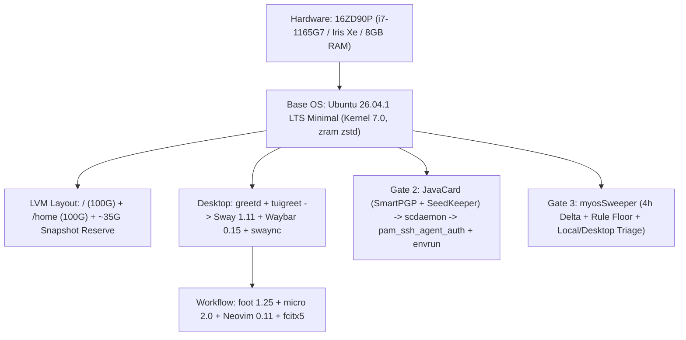

# myOs

A minimal, reproducible, **CLI-first Sway desktop** built on **Ubuntu Server 26.04.1 LTS Minimal** (`Linux 7.0`), engineered for low-RAM hardware (**8GB soldered RAM**, `LG gram 16ZD90P-GX7BK`) with hardware-backed JavaCard authentication and an autonomous `/` security sweeper.

---

## Core Philosophy

- **Minimal & Reproducible**: `Ubuntu Server 26.04 Minimal` + `bootstrap.sh` + GNU `stow` — no desktop-environment bloat, `snapd` purged, `NetworkManager` + `systemd-logind` native.
- **No-Glyph, Text-Only UI**: Plain ASCII/CJK across `sway`, `waybar`, `swaync`, `wofi`, and `tuigreet` — zero Nerd Font or icon-pack dependencies.
- **Floating-First Ergonomics**: New windows open centered at `800x600` floating and toggle cleanly into tiling (`$mod+space`).
- **8GB RAM Budget**: `zram` (`zstd`, 50% RAM), `docker.socket` on-demand activation, and heavy AI/ML workloads offloaded over Tailscale.
- **Hardware-Backed Auth + Full Fallback**: JavaCard (`SeedKeeper` + `SmartPGP` `nistp256`) handles SSH, Git signing, `sudo`/`sudo-i`, and `.env` encryption with 100% password/offline-key fallback.
- **Standalone Security Sweeper**: `myosSweeper` monitors `/` deltas, listening ports, SUID changes, and auth logs without any external commercial AI CLI dependency.

---

## Design Intent (Why Each Component)

- **Ubuntu Server 26.04 LTS Minimal**: Chosen as the base for **ROS 2** readiness (first-class Ubuntu support for future robotics work) paired with 5-year LTS stability and zero desktop bloat.
- **Sway + Wayland**: Selected purely for **hardware resource efficiency** on 8GB soldered RAM—minimal idle footprint with native Wayland performance and full GUI compatibility.
- **JavaCard Hardware Key**: Inspired by the **CAC (Common Access Card)** workflow from military service—practical, tamper-resistant physical authentication for SSH, Git, `sudo`, and `.env` secrets.
- **`myosSweeper` (Self-Hosted AI HIDS)**: Built as a testbed for a **self-hosted, AI-assisted HIDS (Host-based Intrusion Detection System)** that runs independently of any commercial coding agent or cloud API.

---

## Architecture Overview



---

## Stack & Verified Footprint

| Component | Version / Configuration |
| :--- | :--- |
| **OS / Kernel** | Ubuntu 26.04.1 LTS (`resolute`), `Linux 7.0.0-43-generic` |
| **Window Manager** | `sway 1.11`, `waybar v0.15.0`, `swaync`, `wofi`, `tuigreet` |
| **Terminal / Editors** | `foot 1.25.0`, `micro 2.0.15` (`$EDITOR`), `Neovim v0.11.6` |
| **Audio / Network / BT** | `pipewire` + `wireplumber`, `NetworkManager`, `bluez` + `bluetui` |
| **Power / Memory** | `tlp` + `thermald`, `zram0` (`3.5G zstd`) + `/swap.img` fallback |
| **Idle / Active Footprint** | ~2.8 GiB RAM (with Brave active), `/` ~15 GiB used, `/home` ~3.8 GiB used |

---

## Quick Start (Fresh Ubuntu Server 26.04 LTS Minimal)

```bash
sudo apt update && sudo apt install -y git
git clone https://github.com/raybeak/myOs.git ~/myOs
cd ~/myOs
./bootstrap.sh --dry-run   # preview actions
./bootstrap.sh             # deploy packages, stow dotfiles, /etc, services, netplan
sudo reboot
```

### Repository Structure

- `bootstrap.sh`: Idempotent 8-stage installer (`remove.txt` -> `packagesV2.txt` -> external tools -> `stow` -> `/etc` -> `servicesV2.txt` -> `micro` default -> `NetworkManager` cutover).
- `dotfiles/`: GNU `stow` packages (`sway`, `waybar`, `swaync`, `foot`, `micro`, `fcitx5`, `gnupg` with `--no-folding`, `shell`, `btop`, `Thunar`, `gtk-3.0/4.0`).
- `etc/`: System configs (`greetd/config.toml`, `netplan/01-nm.yaml`, `systemd/zram-generator.conf`, `tlp.d/90-gram.conf`, `sudoers.d/ssh-agent`, `security/authorized_keys`).
- `sweeper/`: Standalone `/` security delta collector, rule floor, local/Tailscale triage, and `systemd` timers.
- `gate2JavaCardStarter.md` / `gate3SweeperStarter.md`: Module setup & operational guides.

### Workspace `.env` Helpers (`env*`)

Defined in `dotfiles/shell/.config/myos/env-helpers.sh` (Dual-Recipient GPG encryption using `~/.config/myos/gpg-recipients`, resolving `./.env.gpg` first and falling back to `~/workspace/.env.gpg`):

- `envlock [src] [dst]`: Encrypts a plaintext `.env` file into `.env.gpg` for both the JavaCard key and offline/fallback key (`envlock /dev/shm/.env ~/workspace/.env.gpg` recommended to keep plaintext off NVMe).
- `envview [src]`: Decrypts `.env.gpg` directly to stdout without writing plaintext to disk.
- `envrun <command> [args...]`: Decrypts `.env.gpg` in memory and injects variables into an isolated subshell for `<command>` (`ENV_GPG_FILE` overrides path).

---

## Updates

- `fix(shell): guard bash-only env-helpers.sh in .profile for dash/tuigreet`; `2026-11-17 17:41 KST`
- `chore(repo): untrack compiled __pycache__ bytecode`; `2026-11-17 16:51 KST`
- `feat(gnupg): add pinentry-labeled wrapper for explicit PIN/key titles`; `2026-11-17 16:50 KST`
- `feat(auth): integrate JavaCard SmartPGP, sudo-rs PAM, and .env GPG helpers`; `2026-11-17 16:48 KST`
- `feat(sweeper): add external port details to alerts and Gate 3 starter guide`; `2026-11-17 16:46 KST`
- `feat(sweeper): add Gate 3 myosSweeper pipeline and waybar sec heartbeat`; `2026-11-16 19:08 KST`
- `chore(base): clean Gate 1 Ubuntu 26.04 LTS baseline`; `2026-11-16 17:05 KST`

---

## Acknowledgments

Built and verified with **Antigravity CLI**.
