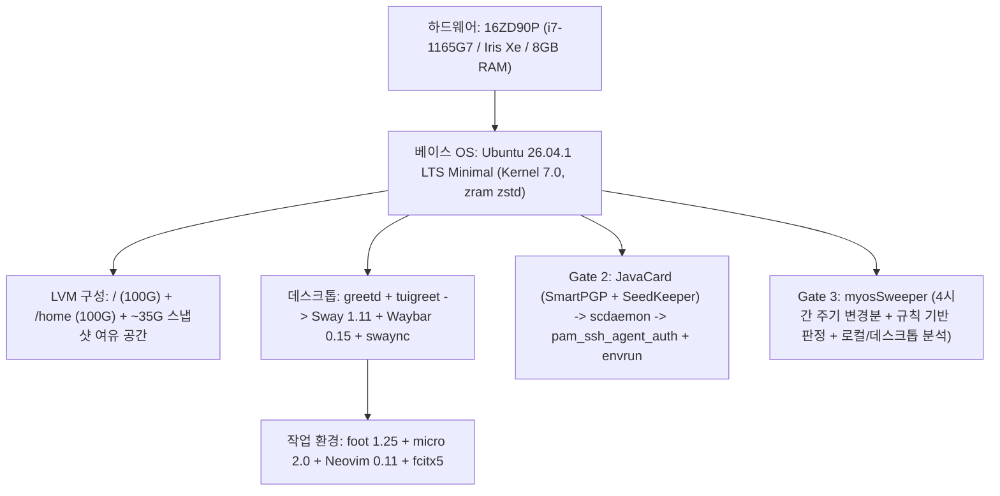

<!-- Korean README style rule: use 노트북/notebook instead of 랩톱/laptop -->
# myOs

> [English README](README.md)

**Ubuntu Server 26.04.1 LTS Minimal**(`Linux 7.0`) 기반의 경량·재현 가능한 **CLI 우선 Sway 데스크톱** 환경입니다. 저용량 메모리 하드웨어(**8GB 온보드 RAM**, `LG gram 16ZD90P-GX7BK`)를 기준으로 설계되었으며, 하드웨어 기반 JavaCard 인증과 독립형 `/` 보안 감시 도구(`myosSweeper`)를 통합했습니다.

---

## 핵심 설계 원칙

- **최소 구성 및 재현성**: `Ubuntu Server 26.04 Minimal` + `bootstrap.sh` + GNU `stow` 조합으로 데스크톱 환경의 불필요한 패키지를 배제하고 `snapd`를 제거했으며, `NetworkManager`와 `systemd-logind`를 네이티브로 사용합니다.
- **아이콘 없는 텍스트 전용 UI**: `sway`, `waybar`, `swaync`, `wofi`, `tuigreet` 전반에 순수 ASCII/한글·CJK 텍스트만 사용해 Nerd Font나 아이콘 팩 의존성이 없습니다.
- **Floating 우선 창 관리**: 새 창은 화면 중앙 `800x600` floating 상태로 열리며, `$mod+space`로 즉시 tiling 전환이 가능합니다.
- **8GB RAM 예산 최적화**: `zram` (`zstd`, RAM 50%), `docker.socket` 필요 시점(on-demand) 활성화, 고부하 AI/ML 작업은 Tailscale 경유 외부 머신으로 오프로드합니다.
- **하드웨어 인증 + 100% 폴백**: JavaCard (`SeedKeeper` + `SmartPGP` `nistp256`)로 SSH, Git 서명, `sudo`/`sudo-i`, `.env` 암호화를 처리하되, 패스워드 및 오프라인 키 폴백을 완전히 보장합니다.
- **독립형 보안 감시 (`myosSweeper`)**: 상용 AI CLI 의존성 없이 `/` 파일시스템 변경분(delta), 리스닝 포트, SUID 변경, 인증 로그를 자체 감시합니다.

---

## 구성 요소별 설계 의도

- **Ubuntu Server 26.04 LTS Minimal**: 향후 로보틱스 작업을 위한 **ROS 2** 네이티브 지원과 5년 LTS 안정성, 데스크톱 블로트 제로를 위해 베이스 OS로 채택했습니다.
- **Sway + Wayland**: 8GB 온보드 RAM 환경에서 유휴 메모리 점유율을 최소화하고 네이티브 Wayland 성능과 GUI 호환성을 확보하기 위해 선택했습니다.
- **JavaCard 하드웨어 키**: 군 복무 시 사용하던 **CAC (Common Access Card)** 운용 방식에서 착안해 SSH, Git, `sudo`, `.env` 시크릿에 대한 변조 방지 물리 인증을 적용했습니다.
- **`myosSweeper` (자체 호스팅 AI HIDS)**: 상용 코딩 에이전트나 클라우드 API 없이 동작하는 **자체 호스팅 AI 보조 호스트 침입 탐지 시스템(HIDS)** 테스트베드로 구축했습니다.

---

## 아키텍처 개요



---

## 소프트웨어 스택 및 실측 점유율

| 구성 요소 | 버전 / 설정 |
| :--- | :--- |
| **OS / 커널** | Ubuntu 26.04.1 LTS (`resolute`), `Linux 7.0.0-43-generic` |
| **창 관리자** | `sway 1.11`, `waybar v0.15.0`, `swaync`, `wofi`, `tuigreet` |
| **터미널 / 편집기** | `foot 1.25.0`, `micro 2.0.15` (`$EDITOR`), `Neovim v0.11.6` |
| **오디오 / 네트워크 / 블루투스** | `pipewire` + `wireplumber`, `NetworkManager`, `bluez` + `bluetui` |
| **전원 / 메모리** | `tlp` + `thermald`, `zram0` (`3.5G zstd`) + `/swap.img` 폴백 |
| **유휴 / 활성 점유율** | RAM ~2.8 GiB (Brave 실행 기준), `/` ~15 GiB 사용, `/home` ~3.8 GiB 사용 |

---

## 빠른 시작 (신규 Ubuntu Server 26.04 LTS Minimal 기준)

> **운용 전제**: `myOs`는 **로컬 물리 콘솔(노트북 직접 조작) 전용**으로 설계되었으며, 원격/무인 SSH 서버용이 아닙니다. `bootstrap.sh`는 엄격한 노트북 우선 보안 정책(`UFW` 인바운드 기본 차단 및 Tailscale `41641/udp`만 허용, `SSHD` 패스워드 인증 비활성화, `NetworkManager` netplan 전환, JavaCard `sudo`/SSH 인증용 Wayland `pinentry-labeled` 확인)을 적용합니다. 활성 `SSH_CONNECTION` 상태에서 실행하면 잠금 위험이 있는 `SSHD` 및 `UFW` 전환 단계는 경고 출력 후 자동으로 건너뜁니다.

```bash
sudo apt update && sudo apt install -y git
git clone https://github.com/raybeak/myOs.git ~/myOs
cd ~/myOs
./bootstrap.sh --dry-run   # 실행 예정 작업 미리보기
./bootstrap.sh             # 패키지, dotfiles stow, /etc, 서비스, netplan 배포
sudo reboot
```

### 저장소 구조

- `bootstrap.sh`: 멱등적(idempotent) 8단계 설치 스크립트 (`remove.txt` -> `packagesV2.txt` -> 외부 도구 -> `stow` -> `/etc` 및 `UFW` 기본 설정 -> `servicesV2.txt` -> `micro` 기본값 -> `NetworkManager` 전환)
- `dotfiles/`: GNU `stow` 패키지 (`sway`, `waybar`, `swaync`, `foot`, `micro`, `fcitx5`, `--no-folding` 적용 `gnupg` 및 `myos-bin`, `shell`, `btop`, `Thunar`, `gtk-3.0/4.0`)
- `etc/`: 시스템 설정 (`greetd/config.toml`, `netplan/01-nm.yaml`, `systemd/zram-generator.conf`, `tlp.d/90-gram.conf`, `sudoers.d/ssh-agent`, `sudoers.d/myos-battery`, `local-sbin/myos-battery-ctl`, `security/authorized_keys`, `ssh/sshd_config.d/01-hardening.conf`, `sysctl.d/99-hardening.conf`)
- `sweeper/`: 독립형 `/` 보안 변경분 수집기, 규칙 기반 판정, 로컬/Tailscale 트리아지, `systemd` 타이머
- `justfile`: 결정적 읽기 전용 검증 진입점 (`just check`: `lint-sh`, `lint-sway`, `eval-sweeper`; `just check-packages`)
- `gate2JavaCardStarter.md` / `gate3SweeperStarter.md` / `myosBinGuide.md` / `recoveryRunbook.md`: 모듈별 구축, 운영 및 복구 가이드

### `myOs` CLI 도구 모음 (`~/.local/bin/myos-*`)

`dotfiles/myos-bin` (`--no-folding`)을 통해 `~/.local/bin/`에 배포되는 텍스트 전용 데스크톱·시스템 유틸리티입니다. 도구별 상세 안내는 `myosBinGuide.md`를 참고하세요.

- `myos-menu` (`$mod+Alt+space`): 통합 `wofi --dmenu` 액션 센터 (상태 토글, 스크린샷, TUI/WebApp 실행기, 보안/시스템 작업, Sway 단축키 모음, 전원 메뉴)
- `myos-screenshot` (`Print` / `Shift+Print`): 영역/전체 화면 캡처를 `~/photo/screenshots/`에 저장하고 클립보드(`wl-copy`)로 복사
- `myos-toggle-idle` / `myos-toggle-nightlight`: `swayidle` 자동 잠금 해제(카페인 모드) 및 `wlsunset` 야간 색온도 토글 (`status` 조회 지원)
- `myos-brightness` (`Fn+F2` / `Fn+F3`): `systemd-logind` 시트 권한 백라이트 제어 (5% 단위 스냅, 최소 `2%` 하한, `--locked`)
- `myos-toggle-touchpad` (`Fn+F5`): Sway 터치패드 토글 및 `tpad_led` 상태 LED 동기화 (루트 권한 불필요)
- `myos-toggle-charge` (`Fn+F1`): LG 배터리 보호 모드(80%)와 완전 충전(100%) 전환
- `myos-display` (`Fn+F7` / `$mod+p`): Sway 네이티브 `get_outputs` + `wofi` 디스플레이 출력 전환기
- `myos-launch-tui` / `myos-webapp`: 표준화된 floating `foot` TUI 래퍼 (`app_id=myos-tui`) 및 프레임리스 Brave `--app=` `.desktop` 관리 도구
- `myos-update`: `apt upgrade` 실행 전 LVM 스냅샷 보호 (`ubuntu-vg/myos-pre-*`, `8G`, 최근 2개 유지, VG 여유 공간 사전 확인)

### 키맵 (Sway 및 LG gram `16ZD90P` Fn 키)

`dotfiles/sway/.config/sway/config`에 정의되어 있으며(`$mod` = `Mod4` / `Super`), 하드웨어 `Fn` 키는 `xev` 및 실기 테스트로 검증되었습니다.

```text
=== 핵심 및 시스템 ===
$mod+Return           foot (터미널)
$mod+d                wofi --show drun --term foot (앱 런처)
$mod+Alt+space        ~/.local/bin/myos-menu (액션 센터; $mod+Mod1+space)
$mod+Shift+q          포커스된 창 닫기
$mod+Shift+c          sway 설정 다시 읽기
$mod+Escape           ~/.config/sway/scripts/power.sh (전원 메뉴)
$mod+Shift+x          swaylock -f -c 000000 (화면 잠금)
Print / Shift+Print   ~/.local/bin/myos-screenshot region | full (영역 / 전체 캡처)

=== Floating 및 창 제어 ===
$mod+space            floating 전환
$mod+Shift+space      floating <-> tiled 포커스 전환
$mod+f                전체 화면 전환
$mod+c                창을 화면 중앙으로 이동
$mod+m                작업 영역 최대화 (너비 100ppt, 높이 100ppt)
$mod+Shift+r          기본 크기(800x600) 및 중앙 위치로 초기화
$mod+LeftDrag         floating 창 이동 ($mod 없이 타이틀바 드래그 가능)
$mod+RightDrag        floating 창 크기 조절 ($mod 없이 테두리 드래그 가능)

=== 포커스, 이동 및 레이아웃 ===
$mod+h/j/k/l (방향키) 좌 / 하 / 상 / 우 포커스 이동
$mod+Shift+h/j/k/l    창 20px 이동 (tiling 상태에서는 위치 교환)
$mod+b / v            가로 분할 (splith) / 세로 분할 (splitv)
$mod+s / w / e        stacking / tabbed / 분할 전환 레이아웃
$mod+a                상위 컨테이너(parent) 포커스
$mod+1..9, 0          워크스페이스 1..10 전환 (+ Shift: 창 이동)
$mod+Shift+minus      scratchpad로 이동 ($mod+minus: scratchpad 표시)
$mod+r                크기 조절 모드 진입 (h/j/k/l 또는 방향키: 20px, Enter/Esc: 종료)

=== 하드웨어 / Fn 키 (LG gram 16ZD90P) ===
Fn+F1  (XF86Launch6, kc 193)                myos-toggle-charge toggle (80% <-> 100%, root 헬퍼)
Fn+F2  (XF86MonBrightnessDown, --locked)    myos-brightness down 5 (logind D-Bus, 2% 하한)
Fn+F3  (XF86MonBrightnessUp, --locked)      myos-brightness up 5
Fn+F4  (EC 차단)                            미사용 (userspace 이벤트 없음)
Fn+F5  (XF86TouchpadToggle, kc 199)         myos-toggle-touchpad toggle (Sway + logind tpad_led)
Fn+F6  (EC 비행기 모드/무선)                EC 하드웨어 제어 (바인딩 금지)
Fn+F7  (Super_L+p -> $mod+p)                myos-display (Sway get_outputs + wofi)
Fn+F8  (EC 키보드 백라이트)                 EC 하드웨어 제어 (0 -> 127 -> 255, OS 바인딩 불필요)
Fn+F9  (XF86Launch5, kc 192)                myos-toggle-nightlight toggle (wlsunset 3750K)
Fn+F10 (XF86AudioMute, --locked)            wpctl set-mute @DEFAULT_AUDIO_SINK@ toggle
Fn+F11 (XF86AudioLowerVolume, --locked)     wpctl set-volume @DEFAULT_AUDIO_SINK@ 5%-
Fn+F12 (XF86AudioRaiseVolume, --locked)     wpctl set-volume -l 1.0 @DEFAULT_AUDIO_SINK@ 5%+
XF86AudioMicMute (--locked)                 wpctl set-mute @DEFAULT_AUDIO_SOURCE@ toggle
XF86AudioPlay / Next / Prev                 playerctl play-pause / next / previous
```

- 참고: Waybar의 `VOL:` / `BRI:` 모듈은 오작동 방지를 위해 읽기 전용(스크롤 비활성화)입니다.

### 워크스페이스 `.env` 암호화 도구 (`env*`)

`dotfiles/shell/.config/myos/env-helpers.sh`에 정의되어 있습니다 (`~/.config/myos/gpg-recipients` 기반 이중 수신자 GPG 암호화; 현재 디렉터리의 `./.env.gpg`를 우선 탐색하고 없으면 `~/workspace/.env.gpg` 사용):

- `envlock [src] [dst]`: 평문 `.env` 파일을 JavaCard 키와 오프라인/폴백 키 모두로 복호화 가능한 `.env.gpg`로 암호화 (NVMe 디스크에 평문을 남기지 않기 위해 `envlock /dev/shm/.env ~/workspace/.env.gpg` 권장)
- `envview [src]`: 디스크에 평문을 쓰지 않고 `.env.gpg`를 표준 출력으로 복호화
- `envrun <command> [args...]`: `.env.gpg`를 메모리에서 복호화해 격리된 서브쉘 환경 변수로 주입한 뒤 `<command>` 실행 (`ENV_GPG_FILE` 환경 변수로 경로 변경 가능)

### 검증 진입점 (`just`)

`justfile`에 정의된 읽기 전용 검증 명령입니다 (`sudo` 사용 및 시스템 변경 없음):

- `just` / `just --list`: 사용 가능한 검증 레시피 목록 출력
- `just check`: 전체 읽기 전용 검증 스위트 실행 (`lint-sh` + `lint-sway` + `eval-sweeper`)
- `just lint-sh`: POSIX 로그인 `.profile` (`sh -n` + `shellcheck -s sh`) 및 Bash 스크립트(`bootstrap.sh`, `etc/local-sbin/myos-battery-ctl`, `env-helpers.sh`, `myos-*`, Waybar/Sway 스크립트) 문법·정적 검사
- `just lint-sway`: Sway 설정 문법 검증 (`sway -C -c dotfiles/sway/.config/sway/config`)
- `just check-packages`: `packagesV2.txt`의 모든 패키지가 로컬 `apt` 캐시에 존재하는지 확인 (`apt-cache show`)
- `just eval-sweeper`: `myosSweeper` 오프라인 평가 스위트 실행 (`sweeper/evals/runEval.py`)

---

## 업데이트 이력

- `docs(readme): add full Korean documentation (readmeKR.md) and link from README.md`; `2026-11-23 18:21 KST`
- `docs(readme): document justfile verification recipes`; `2026-11-23 12:08 KST`
- `feat(dev): add justfile verification entrypoint and dev CLI packages (just, shellcheck, shfmt, git-delta, gh)`; `2026-11-23 12:02 KST`
- `docs(readme): replace Fn-only keymap with unified Sway and LG gram Fn keymap`; `2026-11-23 10:27 KST`
- `chore(myos): wire new controls into myos-menu, prune legacy waybar scripts, audit packagesV2, and add recoveryRunbook.md`; `2026-11-20 15:25 KST`
- `feat(battery): add Fn+F1 myos-toggle-charge (80% Care <-> 100% temporary Full) with root-owned helper and strict sudoers`; `2026-11-20 15:18 KST`
- `feat(fn-keys): add myos-toggle-touchpad, myos-display, 3750K nightlight, and LG gram Fn keymap docs`; `2026-11-20 15:06 KST`
- `feat(myos-bin): add modular myos-* CLI toolbox, unified wofi menu, LVM update guard, and myosBinGuide.md`; `2026-11-20 11:46 KST`
- `feat(security): deploy auditd+usbguard+DoT+MAC-rand, Waybar net toggle, root pinentry, and myosSweeper HIDS fixes`; `2026-11-19 18:48 KST`
- `feat(hardening): add reproducible laptop-only SSHD, sysctl, UFW, and JavaCard confirm baseline`; `2026-11-19 10:18 KST`
- `fix(shell): guard bash-only env-helpers.sh in .profile for dash/tuigreet`; `2026-11-17 17:41 KST`
- `chore(repo): untrack compiled __pycache__ bytecode`; `2026-11-17 16:51 KST`
- `feat(gnupg): add pinentry-labeled wrapper for explicit PIN/key titles`; `2026-11-17 16:50 KST`
- `feat(auth): integrate JavaCard SmartPGP, sudo-rs PAM, and .env GPG helpers`; `2026-11-17 16:48 KST`
- `feat(sweeper): add external port details to alerts and Gate 3 starter guide`; `2026-11-17 16:46 KST`
- `feat(sweeper): add Gate 3 myosSweeper pipeline and waybar sec heartbeat`; `2026-11-16 19:08 KST`
- `chore(base): clean Gate 1 Ubuntu 26.04 LTS baseline`; `2026-11-16 17:05 KST`

---

## 제작

**Antigravity CLI**로 구축 및 검증되었습니다.
